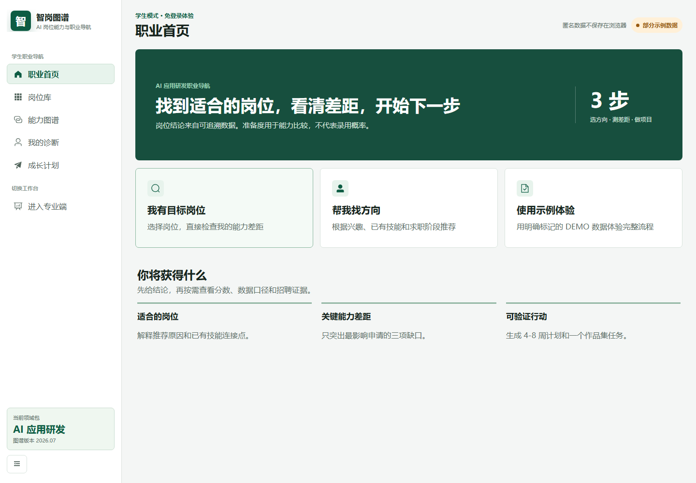
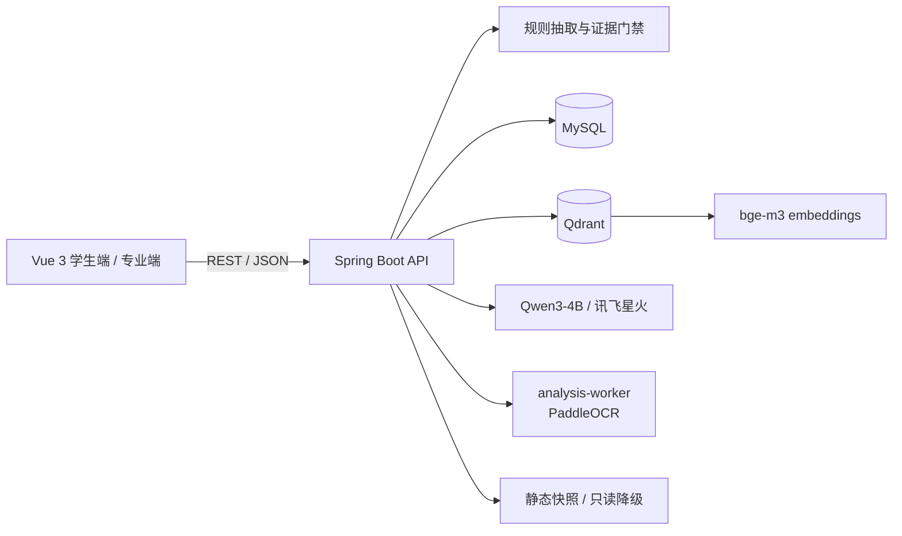

# 智岗图谱（Zhigang Map）

> 把招聘 JD 变成可解释的岗位能力图谱，并用 **LLM + RAG** 做简历诊断、能力差距分析与学习计划。



## 这是什么

智岗图谱是一个面向学生和招聘方的岗位能力分析系统。它把分散的招聘 JD 整理成结构化的岗位、技能和职责图谱，再结合简历证据做岗位匹配与差距分析。

项目重点不是“接一个大模型接口”，而是把 LLM 放进一条**可控、可评测、可降级**的工程链路里：

- 规则优先抽取确定性字段，模型只补规则缺口；
- 每条技能 / 职责都要求能回到原文锚点；
- 模型输出必须通过 JSON Schema 与引用校验；
- 证据不足时拒答或降级到推理模式，不编造；
- 支持本地 Qwen 与讯飞星火切换，默认不依赖付费 API。

## 核心功能

- **岗位能力图谱**：岗位、技能、职责、技术栈、级别与证据来源。
- **新岗位发现**：联网证据 + 向量检索 + LLM 受约束生成，输出岗位定义、职责、技能与置信度。
- **简历解析与匹配**：PDF / DOCX / 扫描件 OCR，解析前脱敏，输出能力差距与学习计划。
- **Agentic RAG 工作流**：查询 → 证据检索 → 证据门禁 → RAG 抽取 / LLM 推理 → JSON 校验 → 人工复核。
- **双端工作台**：学生端做诊断与计划，专业端做数据导入、质量检查、审核与发布。
- **静态 / 动态双模式**：公网静态快照可只读浏览；本地完整模式支持实时 API、向量检索与模型生成。

## 技术栈

| 层 | 技术 |
|---|---|
| 前端 | Vue 3、TypeScript、Vite、Element Plus、Pinia、ECharts、Axios |
| 后端 | Java 17、Spring Boot 3、MyBatis-Plus、MySQL、Redis、Flyway、Spring Security |
| AI / RAG | Qwen3-4B（llama.cpp 本地部署）、讯飞星火 API（可选）、bge-m3、Qdrant、Prompt Engineering、JSON Schema |
| 文档解析 | Apache Tika、PaddleOCR（analysis-worker，FastAPI） |
| 部署 | Docker Compose、Nginx、静态快照 |

## 系统架构



### Agentic RAG 主链路

```text
用户输入岗位 / JD / 简历
        ↓
规则抽取：标题、技能、职责、场景
        ↓
证据切片 → bge-m3 向量化 → Qdrant 检索 → 重排
        ↓
证据充分性判断（企业数 / 来源数 / 字段锚点）
        ├─ 充足 → RAG 结构化抽取
        └─ 不足 → LLM 推理降级（标注 LOW / MEDIUM）
        ↓
JSON Schema 校验 + 原文 offset / citation_id 校验
        ├─ 通过 → 入库 / 展示 / 人工复核
        └─ 失败 → 退回规则结果，不污染已发布数据
```

## 快速开始

### 方式一：静态演示（无需后端、无需 GPU）

适合只看界面和交互：

```bash
docker compose -f docker-compose.static.yml up --build
```

打开 <http://localhost:8088>。静态版使用 `frontend/public/data` 中的冻结快照，不调用模型。

### 方式二：完整本地环境（需要 Docker + NVIDIA GPU）

```bash
cp .env.example .env.local          # macOS / Linux
# Windows PowerShell: Copy-Item .env.example .env.local
# 修改 .env.local 中的数据库密码、专业端账号等
docker compose up -d --build
```

打开：

- 前端：<http://localhost:5173>
- 后端 Swagger：<http://localhost:8080/swagger-ui.html>
- 健康检查：<http://localhost:8080/actuator/health>

首次启动会下载 Qwen3-4B（约 2.3 GB）与 bge-m3 模型，模型只保存在本地 `.models/`，不会提交到仓库。

> 默认 `docker-compose.yml` 使用 NVIDIA GPU 运行 llama.cpp。没有 GPU 时请使用静态演示，或自行将 `bge-m3` / `local-llm` 改为 CPU 镜像。

## 配置

所有配置通过环境变量注入，示例见 [`.env.example`](.env.example)。

- 不要提交 `.env.local`、API Key、数据库密码、Cookie。
- 专业端账号密码必须修改，不能使用示例值。
- 默认 `AI_PROVIDER=local`，不会自动调用讯飞星火；切到 `spark` 会产生费用。
- 向量检索默认使用 `bge-m3`（1024 维）+ Qdrant Cosine。

## 目录结构

```text
.
├── backend/            Spring Boot API、业务服务、测试
├── frontend/           Vue 3 学生端 / 专业端
├── analysis-worker/    FastAPI + PaddleOCR 文档解析
├── collector/          授权数据源采集与去重
├── database/           按编号执行的 MySQL 结构与治理脚本
├── deploy/             Nginx / systemd / 发布脚本
├── docs/               架构、评测、安全、部署文档
├── scripts/            启动、评测、数据治理脚本
├── test-data/          可公开的示例输入 / 输出
└── docker-compose*.yml
```

## 评测

当前仓库保留可复现的评测脚本和部分结果。**不把旧报告里的 95% / 100% 当作当前代码指标。**

| 指标 | 结果 | 口径 |
|---|---:|---|
| JD 技能 + 职责综合 F1 | **88.15%** | 100 条人工金标，已见回归集 v30 |
| JD 技能 F1 | **85.96%** | 同上 |
| JD 职责 F1 | **93.73%** | 同上 |
| 人岗匹配 | 未声明达标 | 210 条诊断集 76.19%，未达到 90% |
| 检索 Recall@5 | 未测 | 仅完成 Qdrant + bge-m3 的 E2E 验证 |
| JSON 格式合格率 / 降级比例 | 未统计 | 有 Schema 校验与降级逻辑，未做聚合指标 |

更完整的口径、样本说明和“不能宣称什么”见 [docs/evaluation.md](docs/evaluation.md)。

## 数据与隐私

- **包含**：`frontend/public/data` 的公开岗位冻结快照；`test-data/examples` 的最小示例。
- 快照中的岗位信息来自公开招聘页面，仅用于演示，版权归原来源。
- **不包含**：真实简历、数据库备份、模型权重、本地 `.env`、比赛私有数据、评测金标。
- 解析简历前会脱敏姓名、电话、邮箱和地址；匿名会话有清理机制。
- 如果复用本项目，请只导入你有权使用的数据，并遵守来源网站的许可与 robots 规则。

## 已知限制

- 本地完整模式需要 NVIDIA GPU；无 GPU 时只能跑静态演示或改 CPU 镜像。
- JD 技能抽取仍是主要短板（技能 F1 85.96%），综合指标未达到 90%。
- 人岗匹配尚未达到 90%，当前结果只作为诊断参考。
- 检索链路没有 Recall@5 标注评测；不要把它描述成“已验证高召回”。
- 前端静态快照与动态 API 是两种运行模式，数据新鲜度不同。

## 文档

- [架构与设计](docs/architecture.md)
- [评测口径](docs/evaluation.md)
- [数据说明](docs/data.md)
- [安全与隐私](docs/security.md)
- [数据库与 Redis](docs/database.md)
- [本地模型部署](docs/local-model.md)
- [静态部署](docs/static-deployment.md)
- [数据与标注规范](docs/data-annotation.md)
- [JD 解析评测记录](docs/evaluation-jd.md)
- [评测遗留问题](docs/evaluation-notes.md)
- [产品决策](docs/product-decisions.md)

## 作者

韩帅文 · 北华航天工业学院 · 数据科学与大数据技术

本项目暂未添加开源许可证。如需复用代码或数据，请先联系作者。
"# zhigang-map" 
