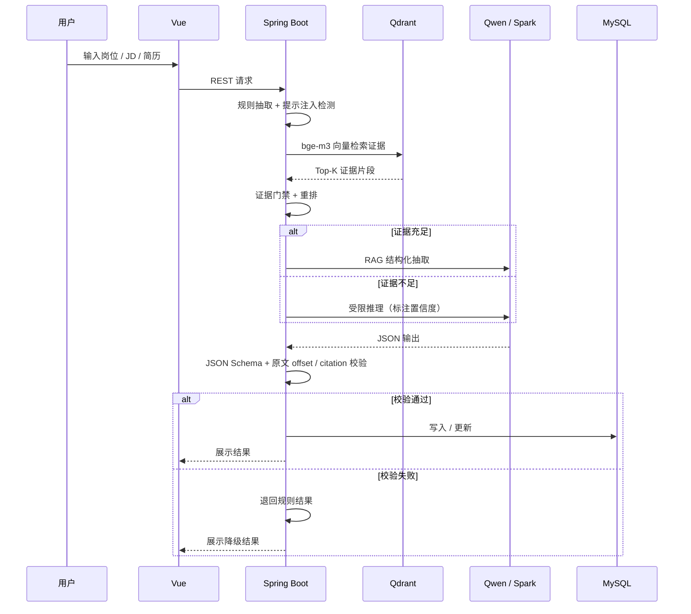

# 架构与设计

## 1. 总览

智岗图谱由四个可独立运行的部分组成：

| 模块 | 职责 |
|---|---|
| `frontend` | Vue 3 学生端 / 专业端，负责诊断流程、图谱可视化、审核工作台 |
| `backend` | Spring Boot API，负责鉴权、业务编排、规则抽取、证据门禁、模型网关 |
| `analysis-worker` | FastAPI + PaddleOCR，负责扫描件 OCR 与策略训练辅助 |
| `collector` | Node.js 授权数据源采集、去重、候选 JD 生成 |

基础设施：MySQL（业务数据）、Redis（会话 / 缓存）、Qdrant（证据向量）、llama.cpp（Qwen3-4B / bge-m3）、Nginx（静态与反向代理）。

## 2. 运行模式

### 静态快照模式

- 只部署 `frontend` 与 Nginx。
- 读取 `frontend/public/data` 中带版本号的 JSON 快照。
- 页面明确标识 `FROZEN_CACHE`，不伪装成实时数据。
- 适合公网只读展示和无 GPU 环境。

### 动态完整模式

- `docker compose up` 启动前端、后端、MySQL、Qdrant、bge-m3、Qwen3-4B、analysis-worker。
- 支持实时 JD 导入、简历解析、向量检索、模型生成和人工审核。
- 前端通过 `/api/*` 访问后端，Nginx 同域代理。

## 3. Agentic RAG 主链路

## 4. 关键设计决策

### 4.1 规则优先，模型补缺

标题、薪资、级别、技能、职责等字段优先用确定性规则抽取；只有规则存在缺口且未命中提示注入时，才调用模型。这样可以降低模型幻觉对已发布数据的影响。

### 4.2 每条结论必须能回到原文

技能、职责、场景等字段都保存 `documentId`、`startOffset`、`endOffset`、`citation_id`。模型输出如果与原文偏移不一致，字段进入异常队列，不进入发布结果。

### 4.3 证据门禁，而不是“有答案就返回”

结论生成前检查独立企业数、独立来源数和字段证据完整性。不满足时固定返回“证据不足”，或进入带置信度标注的推理模式，避免把模型常识伪装成招聘证据。

### 4.4 固定 JSON 契约

模型输出必须满足固定 JSON Schema；字段缺失、类型错误、未声明字段都会导致整体降级。前端只消费通过校验的结构化结果。

### 4.5 本地优先，付费模型手动切换

默认使用本地 Qwen3-4B（llama.cpp）+ 本地 bge-m3，不消耗外部 Token。讯飞星火只在显式配置 `AI_PROVIDER=spark` 时启用，本地模型失败不会自动切换，避免意外费用。

### 4.6 可审计的发布

图谱版本冻结后记录 SHA-256；回滚只重新激活已校验版本，不覆盖历史内容。专业端与审核端职责分离，关键操作需要 CSRF 与角色校验。

## 5. 安全边界

- 输入文本一律视为不可信数据，先做提示注入检测。
- 简历解析前脱敏姓名、电话、邮箱、地址；匿名会话有清理机制。
- 专业端账号、数据库密码、API Key 只通过环境变量注入，不写入仓库。
- 静态部署包不包含后端 JAR、SQL、密码或真实简历。
- 外部 URL 检查限制协议与内网地址，避免 SSRF。

## 6. 目录与代码边界

- `backend/src/main/java/com/zhigang/platform/ai`：模型网关与适配器
- `backend/src/main/java/com/zhigang/platform/analysis`：抽取、证据、向量检索
- `backend/src/main/java/com/zhigang/platform/emerging`：新岗位发现与推理
- `backend/src/main/java/com/zhigang/platform/career`：简历解析、匹配、诊断
- `backend/src/main/java/com/zhigang/platform/reporting`：图谱与报告
- `backend/src/main/java/com/zhigang/platform/governance`：发布与审核
- `frontend/src/views`：学生端 / 专业端页面
- `database/*.sql`：按编号执行的 schema 与治理脚本

## 7. 为什么不用 LangChain / LangGraph

当前后端是 Java / Spring Boot，模型调用、检索、规则校验和降级都在后端服务内直接编排，依赖少、链路可控。LangChain / LangGraph 更适合 Python 快速原型和复杂图编排；如果后续要加入多智能体、人工中断、检查点恢复，可以再引入。
